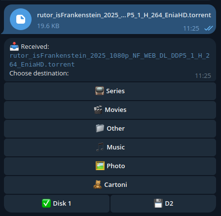
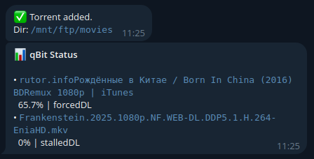
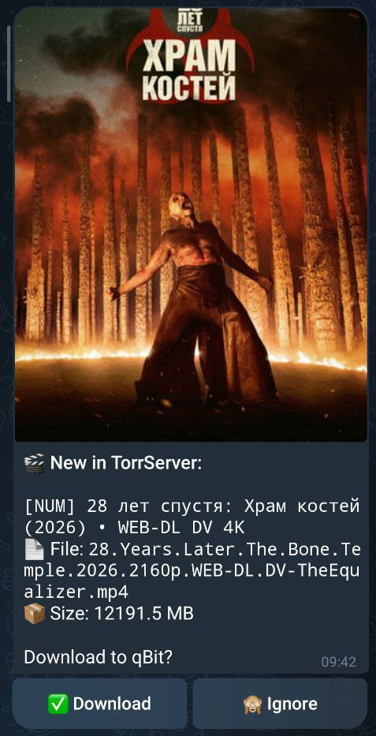

# qBot - Telegram Bot for qBittorrent & MeTube (Go)

A lightweight, high-performance Telegram bot written in **Go** for managing **qBittorrent** and **MeTube** downloads. Send magnet links, `.torrent` files, video/media URLs (YouTube, Vimeo, etc.), or media files directly through Telegram and organize them automatically.

Runs as a lightweight container depending **only on the Docker image and a `.env` file**.

## Example Screenshots





## ✨ Features

- ⚡ **Rewritten in Go**: Fast, minimal resource usage (~15MB Docker image, near-instant startup).
- 🐳 **Pure Docker & `.env`**: Zero external dependencies; no mounting config scripts or installing Python/ffmpeg. Everything is configured via `.env`.
- 📥 **qBittorrent Integration**:
  - Add via magnet links or `.torrent` file uploads (up to 20MB via Telegram Bot API).
  - Track downloads in real-time with `/status`.
  - Automatic completion notifications with configurable action (`stop`, `remove`, `remove_data`).
- 🎬 **MeTube Integration**:
  - Automatically detects video/audio URLs (YouTube, Vimeo, Twitter/X, TikTok, Reddit, Twitch, etc.).
  - Interactive format selection (`🎬 Video` or `🎵 Audio`).
  - Sends download jobs to your [MeTube](https://github.com/alexta69/metube) instance via REST API.
  - Automatically triggers Jellyfin library refresh if configured.
- 💽 **Interactive Disk & Category Menus**:
  - Dynamically displays available free space (in GB) for each configured disk.
  - One-click category/directory selection.
- 🎬 **TorrServer Integration (Optional)**:
  - Rich notifications with posters, media file names, and sizes.
  - One-click "Download to qBittorrent" or "Ignore".
  - Automatic download speed limit enforcement for background downloads.
- 🔒 **Security**: Whitelist protection via `ALLOWED_USER_IDS`.

---

## 🚀 Quick Start (Docker - Recommended)

The bot depends **only on the Docker image and your `.env` file**.

1. **Clone the repository**:
   ```bash
   git clone https://github.com/dominatos/qbittorrent-telegram-bot.git
   cd qbittorrent-telegram-bot
   ```

2. **Create your `.env` file**:
   ```bash
   cp .env.example .env
   nano .env
   ```
   Configure your `BOT_TOKEN`, `ALLOWED_USER_IDS`, `QB_URL`, and `METUBE_URL`.

3. **Start with Docker Compose**:
   ```bash
   docker compose up -d
   ```

4. **Check logs**:
   ```bash
   docker compose logs -f qbot
   ```

---

## ⚙️ Configuration (`.env`)

All configuration is provided through environment variables in `.env`:

```ini
# ------------------------------------------------------------
# Telegram Settings (Required)
# ------------------------------------------------------------
BOT_TOKEN=123456789:ABCdefGhIJKlmNoPQRsTUVwxyZ
ALLOWED_USER_IDS=12345678

# ------------------------------------------------------------
# qBittorrent Settings
# ------------------------------------------------------------
QB_URL=http://127.0.0.1:8080
QB_USER=admin
QB_PASS=adminadmin
# 'stop' (pause), 'remove' (keep files), or 'remove_data' (delete files)
ACTION_ON_COMPLETE=stop

# ------------------------------------------------------------
# Disks & Categories
# ------------------------------------------------------------
DISKS=/mnt/ftp,/mnt/ftp2
DEFAULT_DISK_IDX=0
CATEGORIES=tv:📺 Series,movies:🎬 Movies,download-pc:📁 Other,Music:🎵 Music,vidcontent:🎬 Videos

# ------------------------------------------------------------
# MeTube Settings (Video & Audio Downloads)
# ------------------------------------------------------------
METUBE_ENABLED=true
METUBE_URL=http://127.0.0.1:8081
METUBE_DEFAULT_QUALITY=best
METUBE_DOMAINS=youtube.com,youtu.be,vimeo.com,twitter.com,x.com,instagram.com,tiktok.com,reddit.com,twitch.tv,dailymotion.com

# ------------------------------------------------------------
# Optional Integrations
# ------------------------------------------------------------
TORRSERVER_ENABLED=false
TORRSERVER_URL=http://127.0.0.1:8090
TORRSERVER_DL_LIMIT_MBIT=100

JELLYFIN_ENABLED=false
JELLYFIN_URL=http://127.0.0.1:8096
JELLYFIN_API_KEY=
```

---

## 🎬 MeTube Setup

[MeTube](https://github.com/alexta69/metube) is a self-hosted web GUI for `yt-dlp`. Running MeTube in Docker alongside qBot allows you to offload all video downloads to a dedicated service:

```yaml
services:
  metube:
    image: ghcr.io/alexta69/metube:latest
    container_name: metube
    restart: unless-stopped
    ports:
      - "8081:8081"
    volumes:
      - /mnt/ftp/vidcontent:/downloads
```

When you send any YouTube or video URL to qBot:
1. qBot prompts you to pick format: `[🎬 Video]` (mp4) or `[🎵 Audio]` (mp3).
2. qBot prompts you to choose the destination category/folder.
3. qBot dispatches the download to MeTube via `POST /add`.
4. If Jellyfin is configured, qBot prompts Jellyfin to refresh its library.

---

## 🛠️ Manual Installation (Without Docker)

If you prefer to run the native Go binary:

1. **Install Go 1.22+**:
   ```bash
   # Debian / Ubuntu
   sudo apt install golang
   ```

2. **Build the binary**:
   ```bash
   go build -ldflags="-s -w" -o qbot ./cmd/qbot
   ```

3. **Configure and Run**:
   ```bash
   cp .env.example .env
   nano .env
   ./qbot
   ```

4. **Running as a Systemd Service**:
   ```bash
   sudo cp qtg-torrent-bot.service /etc/systemd/system/
   sudo systemctl daemon-reload
   sudo systemctl enable --now qtg-torrent-bot
   ```

---

## 📖 Telegram Commands & Usage

- **Send a magnet link (`magnet:?xt=...`)** → Interactive category and disk picker with live free space display.
- **Send a `.torrent` file** → Uploads torrent to qBittorrent and starts downloading.
- **Send a video URL** (YouTube, Vimeo, Twitter/X, TikTok, etc.) → Prompts format (Video/Audio) and category, then sends to MeTube.
- **Send media directly (photo / video up to 20MB)** → Saves file directly to the chosen storage directory.
- `/status` → Shows current qBittorrent downloads with progress and links to WebUIs (qBittorrent, MeTube, TorrServer, Jellyfin).
- `/start` or `/help` → Bot information, features, and disk storage stats.
